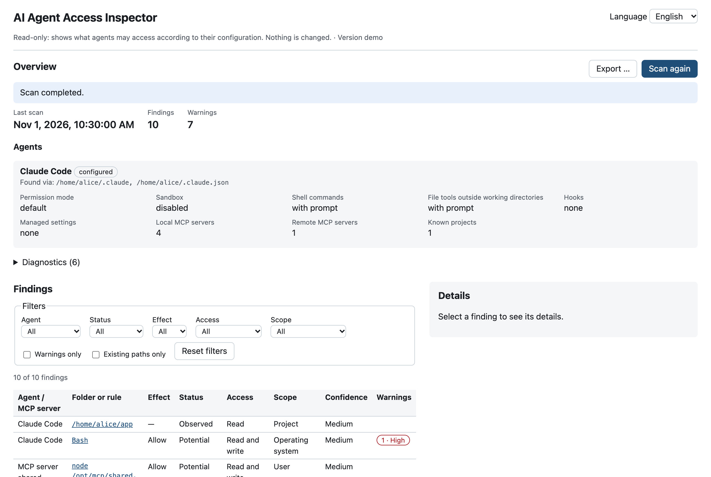
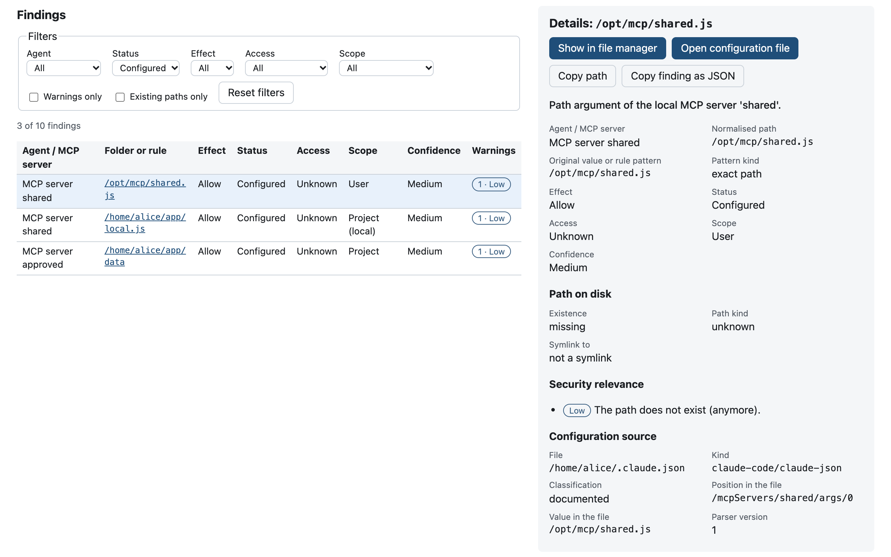
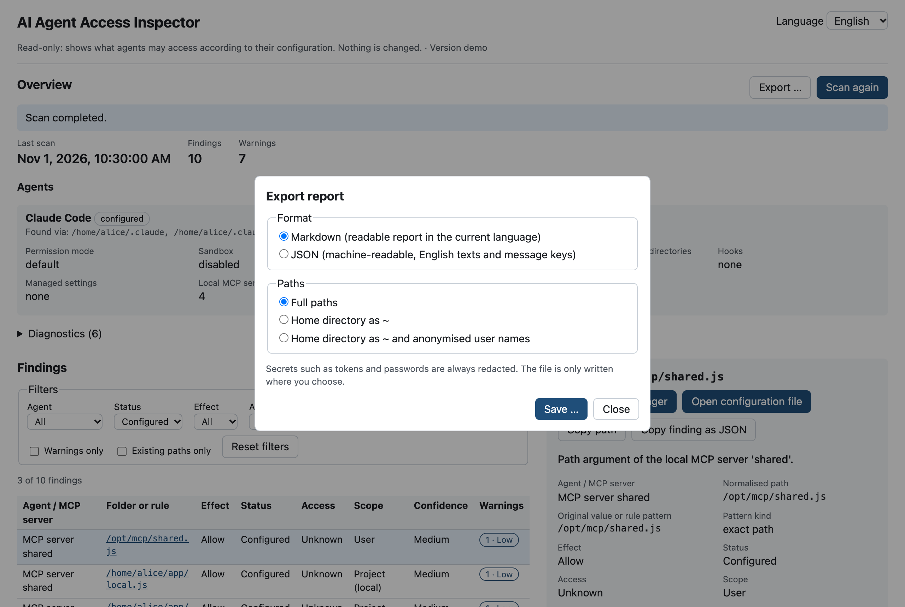

# AI Agent Access Inspector

A local desktop application and command line tool that shows which folders local AI agents can access according to their configuration: what is granted, what is denied, what is only potentially reachable, and why.

The first supported agent is **Claude Code**, including its MCP servers. More agents will follow as separate scanners.

- **Read-only:** it never changes agent configuration and never runs the agent or its MCP servers.
- **Local:** no network access, no telemetry, no account. Nothing leaves your computer unless you export a report yourself.
- **Explained:** every finding names its source file and position, says what it means and warns about broad or sensitive grants.



> **Status:** pre-release (`0.x`). The builds are not signed yet, see [Installation](#installation). The GUI is available in English and German ([German detail view](docs/images/detail-de.png)).

## What it shows

For each detected agent, the application lists the folders and rules that grant, restrict or suggest file access:

| Column | Meaning |
|---|---|
| Folder or rule | the path or permission rule, normalised (`~`, variables and relative paths resolved) |
| Effect | **Allow** (no prompt), **Ask** (prompt), **Deny** |
| Status | **Configured** (written in a configuration), **Observed** (the agent has worked there), **Potential** (reachable through shell commands or system rights), **Blocked**, **Unknown** |
| Scope | where it is configured: **Managed** (administrator), **User**, **Project**, **Project (local)**, … |
| Confidence | how sure the tool is; sources that are not officially documented get at most *medium* |
| Warnings | e.g. the whole home directory, credential folders, missing paths, rules that never take effect |

Selecting a finding shows all details: the original rule, the exact position in the configuration file, whether the path exists, related and conflicting rules, and buttons to show the folder or open the configuration file.



The full data model is described in [docs/findings-model.md](docs/findings-model.md); how Claude Code's configuration is evaluated in [docs/claude-code-scanner.md](docs/claude-code-scanner.md).

## Installation

Download the file for your system from the [releases page](https://github.com/rphki/ai-agent-access-inspector/releases):

| System | File |
|---|---|
| macOS 11 or later (Apple Silicon and Intel) | `ai-agent-access-inspector-gui-<version>-macos-universal.dmg` |
| Windows 10/11 x64 | `ai-agent-access-inspector-gui-<version>-windows-x64-setup.exe` (or `.msi`) |
| Linux x64 | `ai-agent-access-inspector-gui-<version>-linux-x86_64.AppImage` or `…-linux-amd64.deb` |
| command line only | `ai-agent-access-inspector-<version>-<platform>.tar.gz` / `.zip` |

**Check the download** against `SHA256SUMS` from the same release:

```bash
shasum -a 256 -c SHA256SUMS --ignore-missing    # macOS
sha256sum -c SHA256SUMS --ignore-missing        # Linux
```

On Windows: `Get-FileHash <file> -Algorithm SHA256` in PowerShell and compare with `SHA256SUMS`.

**The builds are not signed yet**, so the operating system warns before the first start:

- **macOS:** open the `.dmg` and drag the app to *Applications*. On the first start macOS refuses to open it. Open *System Settings → Privacy & Security*, scroll down and click *Open Anyway* for "AI Agent Access Inspector". Alternatively, in Terminal: `xattr -dr com.apple.quarantine "/Applications/AI Agent Access Inspector.app"`.
- **Windows:** SmartScreen shows "Windows protected your PC". Click *More info → Run anyway*.
- **Linux:** make the AppImage executable (`chmod +x ai-agent-access-inspector-gui-*.AppImage`) and start it, or install the package with `sudo apt install ./ai-agent-access-inspector-gui-*-linux-amd64.deb`. The GUI needs WebKitGTK 4.1 (included in current Ubuntu, Debian and Fedora releases).

## Usage

Start the application. It scans immediately; *Scan again* repeats the scan after you changed a configuration. Use the filters to narrow the list, e.g. to findings with warnings or to paths that exist.

**Export:** *Export …* saves the report as Markdown (readable, in the GUI language) or JSON (machine-readable). Before saving you choose how paths appear: full, with the home directory as `~`, or additionally with anonymised user names. Secrets such as tokens are always redacted. What is read and what is never shown is described in [docs/privacy.md](docs/privacy.md).



**Command line:** the same scan without a GUI, e.g. for scripts:

```bash
ai-agent-access-inspector scan                                   # JSON report of this system
ai-agent-access-inspector scan --format markdown                 # readable report (English)
ai-agent-access-inspector scan --format markdown --paths anonymized
ai-agent-access-inspector list-scanners
```

## Known limitations

- Only the configuration is evaluated, not what an agent actually did or does at runtime. Without a sandbox, shell commands can reach everything your user can; the tool reports this as one *Potential* finding instead of listing every folder.
- Settings given only on the command line or by a server-managed policy, plugins and their MCP servers are not evaluated; MDM profiles are only detected. Details: [Claude Code scanner, known limitations](docs/claude-code-scanner.md#11-known-limitations).
- Redaction of secrets is a heuristic, and anonymisation covers the home directory and user directories only; read an export before you share it ([privacy](docs/privacy.md)).
- Builds are not signed (see above). The GUI has been tested mainly on macOS.

## Development

Requirements: [Rust](https://rustup.rs/) (the version is pinned in `rust-toolchain.toml`), Node.js 24 and pnpm; on Linux the WebKitGTK development packages.

```bash
pnpm install
pnpm tauri dev                                  # GUI with hot reload
pnpm dev:demo                                   # GUI in the browser with example data
cargo run -p inspector-cli -- scan --agent demo # CLI with example data
cargo test --workspace && pnpm test             # tests
```

| Path | Content |
|---|---|
| `crates/inspector-core` | data model, path analysis, scanners, export (without Tauri) |
| `crates/inspector-cli` | command line program `ai-agent-access-inspector` |
| `src-tauri/`, `src/` | desktop GUI (Tauri, React) |
| `fixtures/` | simulated systems with invented data for tests |
| `docs/` | documentation |

- [docs/onboarding.md](docs/onboarding.md): build setup, tests and CI
- [CONTRIBUTING.md](CONTRIBUTING.md): how to contribute
- [docs/adding-a-scanner.md](docs/adding-a-scanner.md): support for another agent
- [docs/architecture.md](docs/architecture.md), [docs/roadmap.md](docs/roadmap.md), [CHANGELOG.md](CHANGELOG.md)

## Security

Please report vulnerabilities privately, see [SECURITY.md](SECURITY.md). The threat model is in [docs/threat-model.md](docs/threat-model.md).

## License

[Apache-2.0](LICENSE)
